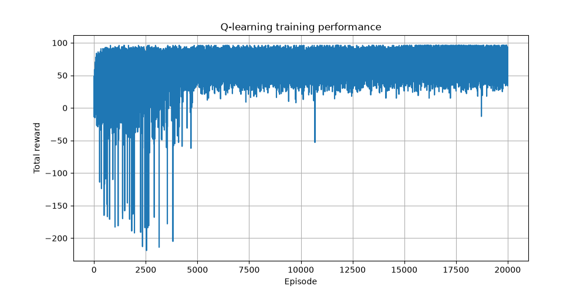
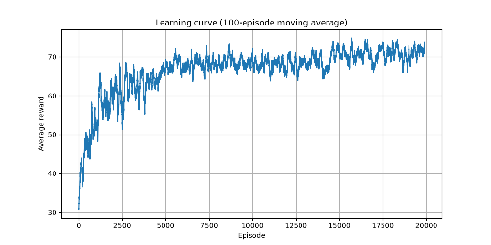
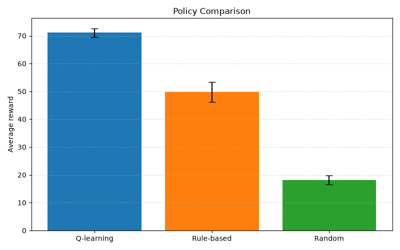

# Q-Learning for Electric Vehicle Charging

## Scenario and Motivation

This project investigates the use of Q-learning for smart charging of an electric vehicle (EV). The task is to determine when the vehicle should be charged during a 24-hour period while electricity prices vary throughout the day.

The agent represents a charging controller that must make a decision every hour. At each timestep, the agent can either charge the battery or wait. Charging increases the battery level but there is a cost that depends on the current electricity price.

The challenge is that the battery must reach a sufficient charge level before the vehicle is needed, while minimizing the total charging cost. Decisions made earlier in the day affect the available battery level later, making this a sequential decision-making problem that is well suited for reinforcement learning.

The environment contains uncertainty through stochastic electricity prices and varying initial battery levels. Both are controlled by a random seed to ensure reproducibility.

---

# Modeling

## States

The state consists of three variables:

- Hour of the day (0–23)
- Battery level (0–10)
- Electricity price level (0–2)

The battery level is discretized into eleven levels:

- 0 = 0%
- 1 = 10%
- ...
- 10 = 100%

The electricity price is discretized into three categories:

- 0 = Low
- 1 = Medium
- 2 = High

The resulting state representation is:

```text
(hour, battery_level, price_level)
```

This gives a total state space of:

```text
24 × 11 × 3 = 792 states
```

which is large enough to create a learning problem while remaining manageable for tabular Q-learning.

## Actions

The agent can choose between two actions:

```text
0 = Do not charge
1 = Charge
```

Charging increases the battery level by one unit (10%) up to a maximum of 100%.

## Episode

One episode represents a single day.

The episode starts at hour 0 and ends after hour 23.

## Reward Function

The reward function was designed to balance charging cost against the goal of reaching a sufficiently high battery level before the end of the day.

For each timestep:

If the agent chooses to charge:

```text
reward -= electricity_price
```

Reward shaping is applied whenever the battery remains below the target level of 80%:

```text
reward -= (8 - battery_level)
```

At the end of the episode:

If the battery level is at least 80%:

```text
reward += 80 + 10 × (battery_level - 8)
```

If the battery level is below 80%:

```text
reward -= 20 × (8 - battery_level)
```

This reward structure encourages the agent to charge when electricity prices are favorable while also motivating it to reach or exceed the target battery level before the end of the day.

## Q-Learning Parameters

The following parameters were used:

```text
Learning rate (α)      = 0.1
Discount factor (γ)    = 0.95
Initial epsilon (ε)    = 1.0
Episodes               = 20,000
```

An epsilon-decay strategy was implemented:

```text
ε = max(0.01, ε × 0.995)
```

This allows the agent to explore early in training and gradually shift toward exploiting learned knowledge.

---

# Results

## Learning Curve

The figures below show the training performance of the agent using a 100-episode moving average.

The learning curve demonstrates a clear increase in reward over time. During the early stages of training, the agent frequently receives lower rewards because it explores many different actions. As training progresses, the average reward increases and eventually stabilizes, indicating that the agent has learned a more effective charging strategy.




## Policy Comparison

The learned policy was compared against two reference strategies.

### Random Policy

Actions were selected randomly at every timestep.

### Rule-Based Policy

A simple heuristic was implemented:

```text
Charge if:
    price == low
    and battery < 80%

Otherwise:
    do not charge
```

Each strategy was evaluated using ten different random seeds. For each seed, the policy was evaluated over 100 episodes and the average reward was recorded.

### Results

| Policy | Average Reward | Standard Deviation |
|----------|----------:|----------:|
| Q-learning | 71.11 | 1.58 |
| Rule-based | 49.76 | 3.55 |
| Random | 18.12 | 1.61 |

The Q-learning agent achieved the highest average reward and clearly outperformed both baseline policies.

The rule-based strategy performed reasonably well because it exploited low electricity prices, but it could not adapt its behavior based on the remaining time in the episode as effectively as the learned policy.

The random policy achieved the lowest reward because charging decisions were made without considering either electricity prices or battery level.



---

# Policy Analysis

Several representative states were examined to understand the behavior learned by the agent.

### State

```text
(hour=0, battery=20%, price=low)
```

Action:

```text
Charge
```

The agent learns that charging is beneficial when the battery level is low and electricity prices are favorable.

### State

```text
(hour=0, battery=70%, price=high)
```

Action:

```text
Do not charge
```

The battery level is already relatively high and there is plenty of time remaining, so the agent postpones charging until conditions improve.

### State

```text
(hour=22, battery=70%, price=low)
```

Action:

```text
Charge
```

Near the end of the episode, the agent recognizes that charging may be necessary to maximize the final battery-related reward.

### State

```text
(hour=19, battery=30%, price=low)
```

Action:

```text
Charge
```

At this point there are exactly enough remaining timesteps to raise the battery level from 30% to 80%, so the agent chooses to begin charging immediately.

### State

```text
(hour=20, battery=30%, price=low)
```

Action:

```text
Do not charge
```

The agent has learned that reaching the target battery level is no longer possible before the episode ends. Rather than paying additional charging costs, it accepts the final penalty.

Overall, the learned policy behaves logically and takes electricity prices, battery level, and remaining time into account when making decisions.

---

# Limitations

This environment is a simplified representation of real-world EV charging.

Several aspects of real charging systems were not included:

- Electricity prices were represented using only three discrete levels.
- Battery charging efficiency was assumed to be perfect.
- Battery degradation was not considered.
- Charging power was assumed constant.
- The vehicle departure time was fixed.
- Only two actions were available: charge or do not charge.

In reality, EV charging systems often support variable charging rates, more complex pricing structures, and dynamic user schedules.

Despite these simplifications, the environment captures the main trade-off between charging cost and battery availability and provides a suitable application of tabular Q-learning.

---

# Conclusion

A Q-learning agent was successfully implemented for an electric vehicle charging problem.

The learned policy outperformed both a random policy and a simple rule-based strategy. The results show that reinforcement learning can learn effective charging behavior by balancing charging cost, battery level, and the remaining time in the episode.

The policy analysis further demonstrated that the agent learned meaningful decision-making behavior, adjusting its actions according to the current battery level, electricity price, and time available before the end of the day.